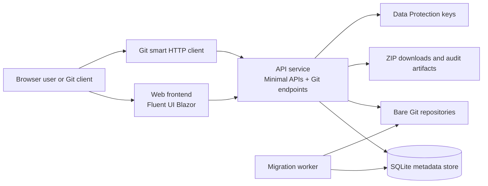

# Pirate Forge Git Server

Pirate Forge is a .NET 10 and Aspire application for hosting private classroom
Git repositories.

## System architecture

The repository follows a small, layered runtime model orchestrated by
`PirateForgeGitServer.AppHost`:

- `PirateForgeGitServer.Web` renders the browser UI and authenticates users
  through the public web experience.
- `PirateForgeGitServer.ApiService` hosts the JSON APIs, authorization rules,
  Git smart HTTP endpoints, and the repository access layer.
- `PirateForgeGitServer.Worker` performs startup and migration work before the
  API becomes ready for traffic.
- `PirateForgeGitServer.Infrastructure` owns SQLite persistence and repository
  filesystem access.



This is a trust-boundary-first design: the API is the only process that touches
SQLite metadata and repository storage. The web app communicates through the API
boundary rather than owning storage access directly. The same pattern extends to
Git traffic, where smart HTTP requests are authorized and validated before the
service invokes Git commands against a repository path.

See [`docs/architecture.md`](docs/architecture.md) for a dedicated overview of the
runtime topology, trust boundaries, and deployment model.

## Solution structure

- `PirateForgeGitServer.AppHost` orchestrates the application with Aspire.
- `PirateForgeGitServer.Web` contains the Fluent UI Blazor v5 user interface.
- `PirateForgeGitServer.ApiService` exposes Minimal APIs and will host Git smart
  HTTP endpoints.
- `PirateForgeGitServer.Domain` contains business rules and entities.
- `PirateForgeGitServer.Application` contains use cases and abstractions.
- `PirateForgeGitServer.Contracts` contains API request and response contracts.
- `PirateForgeGitServer.Infrastructure` owns SQLite and filesystem integration.
- `PirateForgeGitServer.UnitTests`, `PirateForgeGitServer.IntegrationTests`, and
  `PirateForgeGitServer.ArchitectureTests` protect behavior and project
  boundaries.

The API is the only process permitted to access SQLite or repository storage.
The web project communicates with it through service discovery.

## Local development

```powershell
aspire start --isolated
```

Aspire injects `PirateForge__Storage__RootPath` and stores local data under
`.pirateforge`. The storage root contains separate directories for the SQLite
database, bare repositories, generated downloads, and Data Protection keys.
Production containers will map a host volume to this same storage-root contract.

To create the first administrator, configure all three bootstrap settings before
the API starts:

```text
PirateForge__BootstrapAdmin__Email
PirateForge__BootstrapAdmin__Password
PirateForge__BootstrapAdmin__DisplayName
```

The bootstrap is idempotent and doesn't contain a default password. After the
administrator signs in, accounts can be created, activated, reset, deactivated,
and assigned one of the four system roles through the identity API.

## Git access

Administrators and instructors can create bare repositories with
`POST /api/repositories`. Repository names are globally unique and the creating
user owns the repository. Administrators can access every repository.

Git clients use HTTPS smart HTTP and authenticate with the account email as the
username and a personal access token as the password:

Signed-in users create and revoke tokens from **Access tokens** in the Web
navigation. A newly created token is displayed once and should be copied
immediately.

```powershell
git clone https://server.example/course-template.git
git push origin main
```

The service exposes `info/refs`, `git-upload-pack`, and `git-receive-pack`
directly as Minimal API endpoints. Repository paths are derived only from
validated stored names; request values are never passed to a shell.

## Repository browser

Authenticated users can open `/repositories` to see repositories they can
access. The modular Fluent UI Blazor interface supports branch selection,
folder navigation, UTF-8 text-file viewing, recent commit history, and ZIP
downloads.

The browser is backed by authorized Minimal API endpoints under
`/api/repositories/{repositoryName}` for branches, trees, files, commits, and
archives. Branches and repository-relative paths are validated before being
passed to Git. File previews are limited to 1 MiB and reject binary or invalid
UTF-8 content. Commit history is limited to the 100 most recent commits.

## Course management

Administrators and instructors can create courses at `/courses`. Course codes
are globally unique, normalized to uppercase, and limited to safe identifier
characters. The creator is assigned as the first course instructor.

Course instructors and administrators can assign active Instructor and TA
accounts as course staff. Instructors can manage their assigned courses; TAs
have read access to assigned course details. Course lists and detail APIs return
only courses visible to the current user, while administrators retain full
access. A course cannot lose its final instructor.

## Student rosters

Course instructors and administrators can import up to 5,000 students from a
UTF-8 CSV file no larger than 1 MiB. The required header is:

```csv
email,displayName
student@example.edu,Student Name
```

Imports are idempotent. Existing Student accounts are reused, existing
enrollments are left unchanged, and accounts with another role are reported as
conflicts. New accounts are created with the Student role and receive one-time
activation links in the downloaded import-results CSV. Students choose their
password at `/activate` before signing in.

Only administrators and assigned course instructors can view or import a full
roster. Assigned TAs and students cannot access roster endpoints. CSV parsing
supports quoted values and reports malformed rows without discarding valid rows.

## Repository templates and assignments

Administrators and instructors can create repository templates at `/templates`.
Each template is a bare Git repository owned by its creator, so starter code is
pushed through the same HTTPS smart Git endpoints used by other repositories.
Empty templates remain browsable and display setup guidance until their first
branch is pushed.

Assigned course instructors and administrators can create assignments from a
course page. An assignment has a course-unique slug, title, optional
description, optional deadline, and either an accessible repository template or
blank starter code. Templates are isolated by owner for instructors, while
administrators can use any template. Assigned TAs and students can read course
assignments but cannot create them.

Creating an assignment automatically provisions one private bare repository per
currently enrolled student. Template-backed assignments clone every starter ref;
blank assignments initialize empty repositories. Repository names combine the
course, assignment slug, and immutable student identifier, making provisioning
idempotent. Instructors can rerun provisioning from the course page after adding
students or recovering from an interrupted operation.

Students own and can clone, browse, download, and push only their assignment
repositories. Assigned instructors and administrators have read/write access to
every assignment repository in the course. Assigned TAs can clone, browse, and
download them, but Git receive-pack is denied so they cannot push. Unrelated
users cannot discover the repositories.

Administrators and assigned course staff can open an assignment status page
from the course. The single cohort table includes every enrolled student and
shows whether their repository is not provisioned, empty, active, or
unavailable. Provisioned rows link directly to the repository and show its
selected branch plus the latest commit subject, author, timestamp, and short
identifier. Students cannot access the cohort dashboard.

### Automatic grading and AI code review

Each assignment can opt into automatic grading and post-push understanding
questions. When a student pushes to their assignment repository, the receive-pack
workflow queues a background grading run that inspects the repository, runs the
available build/test automation, assigns a numeric score, and stores the result
for the instructor and student to review.

When configured, the same pipeline also generates targeted code-understanding
questions for the student using a local/private model endpoint if one is
available. If the local model is unreachable, the system falls back to a
repository-aware heuristic set of questions so the workflow still provides a
useful review without sending code to external systems.

The grading settings are stored on the assignment itself by `Assignment` and can
be enabled or tuned from the assignment creation request or the assignment
response payload. The default local inference configuration is:

```text
PirateForge__AssignmentGrading__Enabled=true
PirateForge__AssignmentGrading__LocalEndpoint=http://localhost:11434
PirateForge__AssignmentGrading__LocalModel=llama3.2
PirateForge__AssignmentGrading__DefaultQuestionCount=3
```

## Repository downloads and audit activity

Students can download their own assignment repositories. Assigned instructors,
TAs, and administrators can download individual student repositories or one ZIP
containing every provisioned repository for an assignment. Empty and unavailable
repositories are represented by marker files in the assignment-wide ZIP.

Successful individual and assignment-wide downloads are recorded with the
course, assignment, repository when applicable, actor, action, and timestamp.
Administrators and assigned instructors can review the 200 most recent download
events from the course page. TAs may download repositories but cannot view the
course audit history.

## Deployment

The Aspire AppHost publishes a hardened single-host Docker Compose deployment.
See [`docs/deployment.md`](docs/deployment.md) for required parameters, TLS
reverse-proxy configuration, persistent storage permissions, backups, restores,
and upgrades.

Use `aspire stop` before running a command that rebuilds the solution.

```powershell
dotnet build .\PirateForgeGitServer.slnx
dotnet test .\PirateForgeGitServer.slnx --no-build
```
