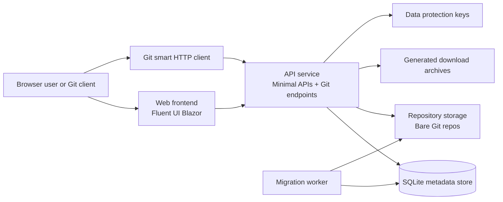

# System architecture

Pirate Forge is a .NET Aspire solution for hosting Git repositories, course assignments, student rosters, and grading workflows behind a single HTTPS entry point. The runtime is intentionally split into a small number of responsibilities so that the public web UI never owns the repository or database access directly.

## Runtime topology

## Component responsibilities

| Component | Primary role | Direct access to SQLite or repository storage |
| --- | --- | --- |
| `PirateForgeGitServer.AppHost` | Starts and wires the distributed application with Aspire | No |
| `PirateForgeGitServer.Web` | Presents the admin, instructor, and student experience in the browser | No |
| `PirateForgeGitServer.ApiService` | Exposes JSON APIs, authentication, course/repository operations, and Git smart HTTP handlers | Yes |
| `PirateForgeGitServer.Worker` | Applies migration and startup tasks before the API becomes ready | Yes |
| `PirateForgeGitServer.Infrastructure` | Persists metadata, permissions, and repository state to SQLite and the filesystem | Yes |
| `PirateForgeGitServer.Domain` and `PirateForgeGitServer.Application` | Host domain rules, use cases, and authorization decisions | No |

The application enforces a clear boundary: the API process is the only component allowed to touch SQLite and repository storage. The web frontend communicates through service discovery and never bypasses the API boundary.

## Security and trust boundaries

1. Browser traffic is served by the Web frontend, which is separated from direct repository persistence.
2. Git clients authenticate over HTTPS smart HTTP with an account email and personal access token.
3. Repository names, assignment slugs, and branch names are validated before they are passed to Git so command injection and unsafe path traversal are avoided.
4. The deployment model binds the API and web services to loopback ports behind a reverse proxy and keeps the storage directory private to the host.
5. The API is responsible for authorization checks for repositories, courses, assignments, and admin-only operations before returning data or executing Git commands.

## Data and operational responsibilities

- Metadata lives in SQLite and includes users, roles, repositories, courses, assignments, roster imports, and audit records.
- Bare Git repositories are stored on disk and accessed by the API through controlled Git endpoints.
- Download ZIP archives are generated as files in the storage root and are still treated as repository-related artifacts rather than primary data.
- Data Protection keys are kept in a dedicated directory so the web app can continue to protect sign-in state across restarts.
- Background and startup work runs through the worker before the API reports health, which keeps migration and persistence setup predictable in local and containerized environments.

## Deployment model

The AppHost publishes a single-host Docker Compose setup for production. The web service is exposed through a TLS-terminating reverse proxy, while Git smart HTTP traffic is routed to the API service on a separate loopback port. This keeps public access limited to the required HTTP surfaces while preserving the internal-only API boundary.

For the live deployment contract, environment variables, volume layout, TLS proxy configuration, and backup/restore procedures, see [deployment.md](./deployment.md). For the end-user and admin features, see [../README.md](../README.md).
